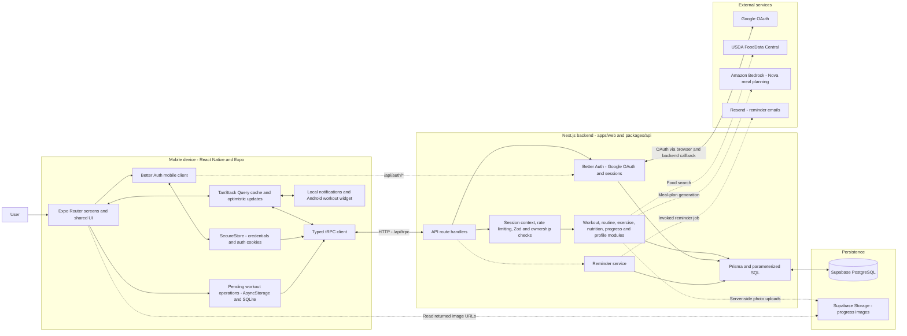

# Kak Fit architecture and Excalidraw walkthrough

This describes the implementation inspected on 2026-11-02. It is an architecture explanation, not a claim that every integration is configured or that every production failure mode has been validated.

## How to introduce the system

> Kak Fit is a mobile-first workout and nutrition application. The client uses React Native, Expo, Expo Router, and TypeScript. TanStack Query manages server data, React state manages screen interactions, and Zustand holds small shared local state such as the rest timer. A typed tRPC client talks to a Next.js backend organized into domain routers. Better Auth handles Google sign-in, and Prisma accesses PostgreSQL hosted on Supabase. Workout logging uses optimistic updates and persisted pending operations to tolerate connectivity failures. Nutrition integrates with USDA and an Amazon Bedrock meal planner that has a deterministic fallback.

The backend is a **modular monolith**: its domain modules run inside one backend application and share a database. The API package is shared source code, not an independently deployed service.

## Drawing 1: overall system

Use four large containers in Excalidraw: Mobile device, Next.js backend, Persistence, and External services. Put the user above the mobile container. Use solid arrows for the core workout request path and dashed arrows for secondary integration paths. Label features that require provider configuration explicitly; a dashed arrow does not mean that the code is missing or planned.



The diagram groups several code paths for readability. Authentication context resolves sessions before protected procedures run; Zod and record ownership checks run in the procedure path. The reminder route calls its reminder service before Resend. Browser-based Google sign-in returns through a backend callback and an app deep link, as detailed below.

Suggested colors: blue for mobile, green for backend, orange for persistence, purple for external services. Use cylinder shapes for PostgreSQL and local persistence. Keep domain modules inside one backend boundary.

### Exact boxes and arrow labels

| Container | Boxes to draw | Main arrows |
|---|---|---|
| Mobile | Screens/shared UI; Query cache; tRPC transport; SecureStore; pending-operation storage; native integration | User -> screens; screens <-> Query; Query <-> tRPC; SecureStore -> transport; pending queues -> transport. |
| Backend | Next.js route handlers; Better Auth; request validation/access checks; domain modules; Prisma | Transport -> `/api/trpc`; auth client -> `/api/auth/*`; guards -> modules -> Prisma. |
| Persistence | PostgreSQL; object storage | Prisma <-> PostgreSQL; photo module -> storage; mobile reads returned image URLs. |
| External | Google; USDA; Bedrock; Resend | Auth <-> Google; nutrition -> USDA/Bedrock; explicitly invoked reminder service -> Resend. |

## Drawing 2: React Native internals

Draw these as layers inside the mobile-device boundary. These are responsibilities, not a claim that every screen has already been refactored into a separate feature folder.

| Layer | Implementation and responsibility |
|---|---|
| App shell | `app/_layout.tsx`: error boundaries, gesture root, safe-area provider, theme, auth, tRPC and Query providers, root navigator, startup handling. |
| Navigation | Expo Router route files. Visible tabs are Home, Workout, Meals, and Profile; stack routes include the active workout, exercise details, routine builder, photos, settings, and developer API. |
| Presentation | Shared UI, theme tokens, responsive layout metrics, loading/error states, dialogs, toasts, charts, exercise rows and forms. |
| Screen behavior | React state, callbacks, feature hooks and form drafts. Some larger screens still combine substantial UI and orchestration. |
| Server state | TanStack Query plus tRPC hooks: request status, cache, per-resource freshness, invalidation and optimistic workout updates. |
| Shared client state | Zustand rest-timer store. Theme and authentication are provided through React context. |
| API transport | tRPC `httpBatchLink`, SuperJSON, auth headers, request timeout, identical GET deduplication and session refresh handling. |
| Device storage | SecureStore for credentials; AsyncStorage for the set-edit queue; SQLite for a second queue of broader workout operations. |
| Native capabilities | Expo image picker, local notifications, AppState/network checks, and an Android workout widget/notification module generated by a config plugin. |

### Explain the state boundaries

| State | Example | Owner | Survives process restart? |
|---|---|---|---|
| Screen interaction | Search input, selected tab/filter, open dialog | React state/navigation | Generally no. |
| Shared local state | Rest-timer values | Zustand | The JS store is in memory; native workout state has separate persistence. |
| Server result | Active workout, routines, history, meals | TanStack Query | The QueryClient shown here is in memory; it is not a persisted copy of the server database. |
| Credentials | App session token and Better Auth cookies | SecureStore | Intended to persist; sessions can expire or require sign-in again. |
| Pending set changes | Add, edit, or delete a workout set | AsyncStorage queue | Yes, subject to successful storage writes. |
| Other pending workout writes | Exercise notes, add-exercise and finish-workout operations | SQLite queue | Yes, subject to successful storage writes. |
| Committed user records | Workouts, routine definitions, meal logs | PostgreSQL | Yes. |

Interview explanation:

> I separate state by ownership and lifetime. API results live in the query cache, transient interactions stay near the screen, shared timer state lives in Zustand, credentials use secure native storage, and pending writes have explicit persistence. PostgreSQL remains the source of truth for committed records.

### Transport details worth explaining

- The mobile client imports `AppRouter` through a type-only entry point. It shares the API contract without bundling Prisma or server-side credentials into the app.
- Zod checks request values at runtime. TypeScript alone cannot validate an incoming network request.
- `httpBatchLink` can group up to 10 calls into one HTTP request, subject to the configured URL-length limit.
- SuperJSON transports values such as dates consistently.
- Identical GETs are deduplicated; mutations bypass that request cache.
- Resource-specific stale times let stable exercise details remain fresh longer than an active workout.
- Global mutation retries are disabled. The workout queues have their own recovery behavior; server-enforced idempotency remains future work.

## Drawing 3: database relationships

Draw only the core entities first. `1 -> many` means one parent can have many children.

```text
User 1 -> many Session
User 1 -> many Account

User 1 -> many Routine
Routine 1 -> many RoutineExercise
RoutineExercise many -> 1 Exercise
RoutineExercise 1 -> many RoutineSet

User 1 -> many Workout
Workout 1 -> many WorkoutExercise
WorkoutExercise many -> 1 Exercise
WorkoutExercise 1 -> many WorkoutSet

User 1 -> many PersonalRecord
Exercise 1 -> many PersonalRecord
WorkoutSet 1 -> many PersonalRecord [optional set reference]

Exercise 1 -> many ExerciseMedia
Exercise many -> many Muscle [via ExerciseMuscle]
Exercise many -> many Equipment [via ExerciseEquipment]

User 1 -> many MealLog
MealLog 1 -> many MealItem
MealItem many -> 1 Food
User 1 -> many MealPlan [unique user and day]

User 1 -> many BodyMeasurement
User 1 -> many ProgressPhoto
User 1 -> many ApiKey
```

The distinction between **Routine** and **Workout** is central. A routine stores intended exercises and target sets. Starting a routine creates separate workout exercise/set records containing actual performance. Later edits to the routine do not rewrite those recorded workout values. A workout with `finishedAt = null` represents an active session.

Useful indexes include workout history by user and completion time, sets by workout exercise and set number, and meal logs by user and date. Food and exercise catalogs can contain shared entries and user-owned custom entries.

Social models also exist in the schema, but they should not dominate a diagram of the current workout/nutrition experience. An existing table alone does not establish a complete product feature.

## Flow A: Google sign-in

```text
Continue with Google
  -> mobile Better Auth client
  -> backend /api/auth/*
  -> Google OAuth in a browser
  -> backend Google callback
  -> Better Auth stores/resolves User, Account and Session
  -> kakfit:// deep-link callback returns to the app
  -> native credentials and auth cookies are saved through SecureStore
  -> AuthProvider updates authentication state
  -> redirect after navigation is ready
  -> authenticated requests carry the app's bearer credential
  -> backend resolves its session/user, using a short process-local cache
```

Google establishes identity; Better Auth handles the application session. The current API resolves database-backed sessions, so describe the authentication as session-backed. Record access also checks ownership, for example that a set belongs to the signed-in user's active workout. A successful login by itself is not authorization to access every workout.

## Flow B: edit and synchronize a workout set

```text
User edits reps or weight
  -> active workout screen calls the set-queue adapter
  -> queue updates the cached workout optimistically
  -> pending operation is persisted in AsyncStorage
  -> ordered queue calls workout.updateSet through tRPC
  -> server resolves session and validates input
  -> update verifies the set belongs to this user's unfinished workout
  -> PostgreSQL returns the committed set
  -> queue reconciles the cache and removes the acknowledged operation
```

On network failure, retries use bounded exponential backoff. When the retry budget is exhausted, the operation remains queued and the screen offers Retry. An add-set operation initially uses a temporary ID, then maps it to the ID returned by the server.

There is also a separate SQLite queue for broader workout actions. `OfflineWorkoutSync` checks for work when authenticated, on app foregrounding, and on a 20-second interval while its JS lifecycle is running. It checks connectivity before synchronizing and invalidates affected queries afterward. This is not an OS-scheduled background worker that is guaranteed to run after the app is killed.

Current limits: the queues do not constitute a full local database replica; user-account namespacing is incomplete; storage errors and concurrent editing need further handling; and structural writes need server-enforced idempotency for safe replay after a lost response. Do not claim exactly-once delivery or a fully offline app.

## Flow C: finish a workout and display progress

```text
Finish workout
  -> user confirms Save Workout
  -> workout.finish
  -> verify ownership and active status
  -> read completed sets and calculate completed-set count and volume
  -> save finish timestamp and summary values
  -> synchronize personal records through the PR service
  -> return workout, new records and a summary
  -> invalidate active workout, history, progress, stats and PR queries
  -> updated queries refresh the UI
```

The current Save Workout action does not explicitly wait for the separate set-edit queue to drain. Adding that completion barrier is further reliability work, particularly if the user finishes immediately after editing a set. The finish handler also writes the workout and synchronizes PRs in successive steps; do not claim that those steps form one atomic transaction. Progress is calculated from persisted workout data and summary values; it is not a separate analytics service.

## Flow D: nutrition and meal planning

There are two different external integrations:

1. **Food search and meal logging:** the nutrition module searches stored foods and/or USDA FoodData Central. Selected foods and quantities are recorded through Food, MealLog and MealItem. Daily summary queries calculate consumed calories and macros.
2. **Meal planning:** the server loads the user's planner profile and recent workout count, calculates nutrition targets in code, and requests a structured plan from Amazon Bedrock. The default model is Nova Lite, with a configurable model ID. The response is parsed, checked with Zod and normalized before a daily MealPlan is stored. If generation fails, a deterministic fallback creates a plan from the available foods. An existing daily plan can be reused without another generation request.

USDA provides food information; Bedrock generates meal-plan suggestions. AWS credentials and the USDA API key stay on the server. These integrations require working configuration; the presence of code is not proof that a live provider request succeeded during the demo.

## Other implemented paths

| Capability | Current path | Diagram note |
|---|---|---|
| Progress photos | Image picker -> authenticated photo upload procedure -> server-side storage client -> Supabase Storage; URL/path/metadata -> ProgressPhoto in PostgreSQL | Image bytes are object storage data, while metadata is relational data. The current storage client creates a public bucket; do not label photos as protected by signed URLs. |
| Android workout controls | Query state -> JS/native adapter -> generated native module, preferences, widget and foreground notification/overlay services; native actions -> JS events/pending IDs -> API synchronization | This is a specific Android integration. Do not promise equivalent iOS behavior or guaranteed background delivery. |
| Local meal reminders | Expo notification scheduling on the device | Separate these from server-sent emails. |
| Reminder emails | Explicit invocation of `/api/jobs/daily-exercise-reminders` or the CLI -> reminder service -> Resend | A job endpoint exists; `vercel.json` does not configure a recurring cron schedule. |
| Developer REST API | External tool -> `/api/v1/*` -> API-key authentication -> handlers -> Prisma/PostgreSQL | Same backend. Database stores API-key hashes; raw keys are shown on generation. OpenAPI and LLM-tool definitions exist. |
| Exercise imports | Wger/Hevy/free-exercise-db import scripts -> catalog/media tables | A data ingestion path, not a required external request for every exercise-screen render. |
| Browser client | Expo web export -> Next.js public assets | Same mobile project can produce web assets; web has platform-specific storage/auth behavior. |

## Deployment drawing

For the current interview demo:

```text
Installed release APK in Pixel emulator
  -> http://localhost:3000 from Android
  -> adb reverse tcp:3000 tcp:3000
  -> Windows Next.js API on 127.0.0.1:3000
  -> configured hosted PostgreSQL connection
```

The APK contains its JavaScript bundle, so normal use requires no Metro server or rebuild. The local backend and ADB port forwarding must be running. The user confirmed that Home loads after signing in.

The repository also supports EAS development/preview/production build profiles and a Vercel-hosted Next.js backend. Preview/production profiles use an HTTPS API URL. The DB layer accepts direct/pooled PostgreSQL URLs and Prisma Accelerate URLs, so draw Accelerate only when describing a configuration that actually uses it. The earlier deployed database connection problem does not affect the confirmed local demo path; deployment health still needs separate verification before public release.

## Code map

| Responsibility | Source |
|---|---|
| Mobile app shell | [Root layout](../apps/mobile/app/_layout.tsx) |
| Navigation tabs | [Tabs layout](../apps/mobile/app/(tabs)/_layout.tsx) |
| Typed API client | [tRPC transport](../apps/mobile/src/lib/trpc.ts), [fetch behavior](../apps/mobile/src/lib/trpc-fetch.ts) |
| Cache policy | [Query options](../apps/mobile/src/lib/query-options.ts), [Query client](../apps/mobile/src/lib/query-client.ts) |
| Auth lifecycle | [Auth provider](../apps/mobile/src/lib/auth-context.tsx), [credential/session helpers](../apps/mobile/src/lib/auth.ts), [sign-out orchestration](../apps/mobile/src/lib/auth-sign-out.ts) |
| Set-edit persistence | [Core](../apps/mobile/src/lib/workout-mutation-queue-core.ts), [native hook adapter](../apps/mobile/src/lib/workout-mutation-queue.ts) |
| Other pending writes | [SQLite queue](../apps/mobile/src/lib/offline-workouts.ts), [sync lifecycle](../apps/mobile/src/components/offline-workout-sync.tsx) |
| Real HTTP entry point | [Next.js tRPC handler](../apps/web/src/app/api/trpc/[trpc]/route.ts) |
| Backend domains | [Root router](../packages/api/src/index.ts), [protected procedure](../packages/api/src/trpc.ts) |
| Backend auth | [Better Auth configuration](../apps/web/src/lib/auth.ts) |
| Workout business logic | [Workout router](../packages/api/src/routers/workout.ts), [PR service](../packages/api/src/services/personal-records.ts) |
| Food and AI planning | [Nutrition router](../packages/api/src/routers/nutrition.ts), [planner service](../packages/api/src/services/nutrition-planner.ts) |
| Data model and connection | [Prisma schema](../packages/db/prisma/schema.prisma), [DB client](../packages/db/src/index.ts) |
| Android native generation | [Workout widget config plugin](../apps/mobile/plugins/with-workout-widget.js) |

## Design choices and tradeoffs to discuss

- **Modular monolith:** fewer deployment and distributed-system concerns for this project's scope. Domain boundaries make future extraction possible, but extraction should follow measured operational needs.
- **Typed tRPC contract plus runtime validation:** compiler assistance for the first-party TypeScript app, with server checks for actual incoming values. REST supports external consumers without sharing TypeScript source.
- **Optimistic workout logging:** immediate feedback for a frequent interaction, at the cost of explicit persistence, reconciliation and retry complexity.
- **Relational modeling:** workouts, exercises and sets have natural relationships and user-owned access patterns. A routine template is separate from recorded performance.
- **Deterministic targets and AI suggestions:** nutrition targets are computed in code, while the model generates meal suggestions. Provider failure has a local server-side fallback.
- **Next production steps:** account-scoped pending storage, idempotent writes, a pending-write barrier before completion, atomic/recoverable completion, shared rate limiting where needed, private photo access, component/device tests, and redacted crash/availability monitoring. Large screen files and exercise pagination are frontend maintainability/performance work.

When presenting, start with Drawing 1, zoom into Drawing 2, and trace a workout-set edit. Show Drawing 3 only when discussing the data model. Keep optional provider and developer-API details for follow-up questions.
