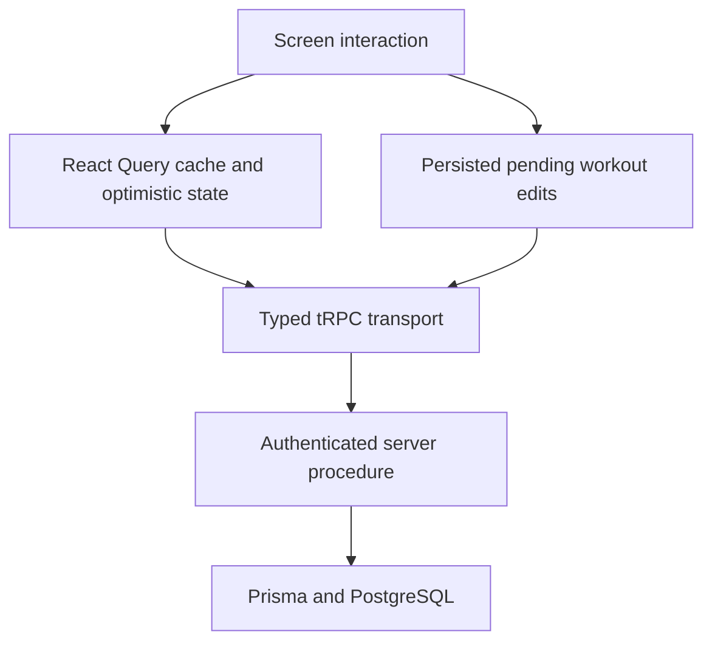

# React Native engineering review and interview walkthrough

Reviewed on 2026-11-02. The app currently uses Expo SDK 54, React Native 0.81, React 19, and TypeScript.

## Assessment

This is a credible React Native portfolio project with real application behavior: authentication, typed server access, workout logging, persisted pending edits, notifications, progress, and nutrition. The technology choices are reasonable. The strongest parts are the shared UI, server-state management, typed API boundary, and attention to persistence.

Production readiness is still incomplete. The largest gaps are deployment health, offline correctness across retries and account changes, automated user-flow coverage, and the amount of behavior concentrated in individual screens. Removing dead code improves maintainability; release readiness also needs evidence that failures and recovery work reliably.

## Changes from this review

- Removed an unreferenced icon module, unused UI components, stale animation helpers, deprecated layout aliases, unused styles, imports, and private arguments.
- Enabled `noUnusedLocals` and `noUnusedParameters` alongside strict TypeScript.
- Removed unused camera and microphone permissions. Photo-library selection remains available.
- API keys are now generated through an explicit button press. Opening the API screen performs a read, and loading failures offer Retry.
- Removed the session-renewal badge and its presentation-only state. Session renewal still runs in the background.
- Kept verbose tRPC logging in development and made release error-boundary messages suitable for app users.
- Disabled blanket write retries. A server can commit a write even when its response is lost.
- Removed the custom JSON query-key hash so TanStack Query can use its stable default hashing.
- Separated cache configuration from the native transport, making the query client testable without loading native modules.
- Fixed previous-set matching: an unmatched set number returns no previous performance instead of another set's values.
- Separated the workout queue core from its React/AsyncStorage adapter. Exhausting network retries now retains the pending edit and optimistic values for retry.
- Added regression tests for lost responses, stable cache keys, previous-set matching, queue retention, recovery after restart, optimistic IDs, and workout isolation.

## Architecture to explain

| Responsibility | Implementation | Reason |
|---|---|---|
| Routes and app shell | `apps/mobile/app`, especially `_layout.tsx` | Expo Router composes screens; the root provides theme, auth, query client, and navigation readiness. |
| Server state | `src/lib/trpc.ts`, `query-client.ts`, `query-options.ts` | Typed requests, caching, invalidation, and resource-specific freshness. |
| Screen interactions | React state and feature hooks | Search text, selected filters, open dialogs, and form drafts belong close to their UI. |
| Shared local state | Zustand stores such as `rest-timer.ts` | Timers and small state shared between a screen and its overlay have a separate lifetime from server data. |
| Native credentials | `auth.ts`, `auth-client.ts` and Expo SecureStore | Credentials survive process restarts using native secure storage. |
| Pending set edits | `workout-mutation-queue-core.ts` | Ordered updates, optimistic values, temporary IDs, persistence, and retry handling. |
| Native queue adapter | `workout-mutation-queue.ts` | Connects the core to React lifecycle, AsyncStorage, and real API executors. |
| Other pending workout operations | `offline-workouts.ts` | SQLite stores operations such as notes and finishing a workout. This is a separate mechanism that should eventually share one consistent contract with the set queue. |
| Native Android integration | `plugins/with-workout-widget.js` | The config plugin generates the native workout notification/widget integration during prebuild. |

### A short project introduction

> Kak Fit is a React Native workout and nutrition app built with Expo and TypeScript. It supports Google sign-in, an exercise catalog, reusable routines, live set logging, rest timers, workout history, and progress views. I use TanStack Query for server state and local state for interactions. Workout edits update the UI optimistically and can be persisted for later sync. The server exposes typed tRPC procedures backed by Prisma and PostgreSQL. The recent hardening work focused on responsive layouts, reliable startup, safer write behavior, and preventing pending edits from being discarded during a network failure.

Use this introduction after understanding the files below. Explain the implementation and its limitations accurately.

### Files to open during an interview

1. [App root](../apps/mobile/app/_layout.tsx): explain providers, the navigator, and why auth redirects wait for navigation readiness.
2. [Query client](../apps/mobile/src/lib/query-client.ts) and [cache options](../apps/mobile/src/lib/query-options.ts): explain read caching, invalidation, bounded retries, and why writes do not retry globally.
3. [Active workout](../apps/mobile/app/workout/active.tsx): follow a set edit into `useWorkoutSetMutationQueue` and the optimistic cache update.
4. [Queue core](../apps/mobile/src/lib/workout-mutation-queue-core.ts) and [recovery tests](../apps/mobile/src/lib/workout-mutation-queue.test.ts): explain retained payloads, temporary IDs, persistence, and acknowledgement before removal.
5. [Auth](../apps/mobile/src/lib/auth.ts): explain Google OAuth, deep-link callbacks, secure credential storage, session recovery, and sign-out.
6. [Shared UI](../apps/mobile/src/components/ui.tsx), [theme](../apps/mobile/src/lib/theme.ts), and [layout metrics](../apps/mobile/src/lib/layout-metrics.ts): explain consistent spacing, safe areas, text scaling, and dialog layout.

### Questions worth practising

**Why TanStack Query rather than putting API results into a global store?**

Server data needs freshness, request status, caching, and invalidation. Query handles those responsibilities. Zustand is used for small shared local state such as the rest timer, while screen-specific interactions use React state.

**What happens when a set is edited without a working connection?**

The queue updates the cached workout optimistically and persists the pending operation. It processes operations in order. If network retries are exhausted, the edit remains queued and the screen offers retry. A regression test recreates the queue from storage and verifies recovery. Server-side idempotency is still needed to fully handle the case where a write commits but its response is lost.

**How does authentication work?**

Google OAuth establishes a Better Auth session. Native credentials are stored through Expo SecureStore, and requests attach bearer credentials. The server resolves the session and applies user-scoped access checks. Do not describe this as purely stateless JWT verification: the server currently looks up sessions in the database.

**How would you approach performance?**

Start with a release build and profile the slow interaction. Paginate growing collections, virtualize long lists, keep expensive work out of repeated renders, and apply memoization where it reduces measured work. Workout history already has a reusable infinite-query helper. Exercise browsing currently fetches only 50 results and renders them in a ScrollView; that screen needs cursor pagination and a virtualized list before claiming the full catalog can be browsed efficiently.

**Why separate the queue core from its hook?**

The core owns queue behavior. The adapter owns React lifecycle, native storage, and network clients. The core can therefore be exercised with an in-memory store and controlled network failures, including recovery across simulated restarts.

**What would you improve next?**

Name concrete work from the table below. Explain the trigger, current behavior, intended behavior, and how you would verify the change.

## Remaining production work

| Priority | Finding and evidence | Next step |
|---|---|---|
| P0 | During this review, the API configured in `eas.json` returned a Prisma Accelerate database connection error (`P6008`). The local interview API returned `db: connected`. | Restore the deployed API's database configuration, deploy the current sanitized health endpoint, and require a successful database health check before a public release. |
| P1 | Pending storage uses app-wide keys/tables. The set queue checks workout identity, but neither mechanism is consistently namespaced by authenticated user. See the queue core, `offline-workouts.ts`, and sign-out in `auth.ts`. | Design account-scoped storage and a migration/recovery policy. Test sign-out, account switching, outstanding requests, and unsynced work without silently deleting edits. |
| P1 | Retrying structural operations such as adding a set can duplicate a server write if the acknowledgement is lost. A local queue ID is not a server idempotency guarantee. | Add server-enforced idempotency keys and test a committed write whose response is lost. |
| P1 | Queue persistence failures are currently logged. Tests now cover normal persistence and network recovery, but storage failure and concurrent editing need more coverage. | Surface storage failures, define conflict behavior, and add failure-injection tests. |
| P1 | Tests cover important pure logic and queue behavior, but there is no automated device flow covering sign-in, log/edit/finish, offline recovery, and account switching. | Run the existing checks in CI, then add component and device tests for those journeys. Validate iOS and a physical Android device. |
| P1 | Error boundaries and console diagnostics exist, but a crash-reporting and release-monitoring service is not configured. | Add redacted crash reporting, release identifiers, and backend availability monitoring. |
| P2 | `nutrition.tsx` is about 2,700 lines and `workout/active.tsx` about 2,000. Both combine orchestration, UI, and styles. | Extract feature components and hooks with clear inputs, preserving behavior through tests. Start with nutrition planning/logging and workout exercise rows. |
| P2 | Exercise browsing requests `limit: 50` without a next-page control and issues a query for each search change. | Add cursor pagination, a virtualized list, and debounced search. Do not solve a rendering problem by deleting exercise records. |
| P2 | `refetchOnReconnect` is set, but there is no app-wide React Query `onlineManager` integration. Workout sync has its own AppState/network checks. | Connect native network and foreground events to query lifecycle behavior and test reconnecting with stale data. |
| P2 | Some icon-only controls, including `HevyIconButton`, do not expose an explicit accessibility-label prop. | Add descriptive labels and roles, and validate key journeys with TalkBack and VoiceOver. |
| P2 | The API has rate limiting, but its limiter uses a process-local Map. | Use a shared limiter when running multiple backend instances. The older claim that there is no rate limiting is no longer accurate. |

## Verification and scope

The cleanup passes mobile and API TypeScript checks, 22 mobile regression tests, and 10 API service tests. Mobile also enforces unused-code checks. The Android release build passed; emulator checks covered 320dp at 130% text scale and 640dp, including dialog containment and aligned tab labels. Opening the API screen kept the active-key count at zero, and all 904 exercise records were retained. The packaged APK has no camera or microphone permission. It uses the local backend described in the README.

In a later cold-start check, the installed app opened to Google sign-in. The emulator subsequently closed before recovery could be verified; the cause is unconfirmed. The restarted local API passed its database health check. Before the interview, use the two commands in the [Windows setup instructions](../README.md), sign in if prompted, and open Home, Workout, and a saved routine. The APK does not need Metro or another build for a normal launch. Do not assume sign-in persistence has been verified across every restart.

This review does not establish physical-device performance, iOS correctness, store compliance, or complete offline synchronization correctness. Those need their own validation before public release. The existing `upgradePlan.md` is an older draft; verify each item against current source before treating it as an active defect.

## Reference material

- React Native's [security guidance](https://reactnative.dev/docs/0.81/security) explains why app bundles cannot safely contain server secrets and why storage choices matter.
- The [FlatList guide](https://reactnative.dev/docs/0.81/optimizing-flatlist-configuration) covers list rendering and responsiveness tradeoffs.
- TanStack Query's [React Native guide](https://tanstack.com/query/latest/docs/framework/react/react-native) describes native online and app-focus integration.
